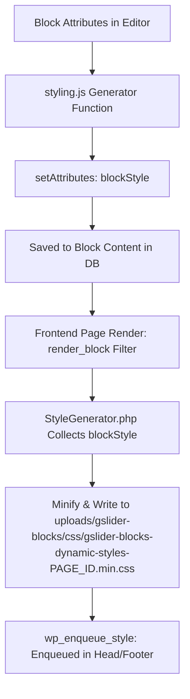

# GSlider Dynamic Style Engine Skill

This skill explains how **GSlider Blocks** generates, manages, and renders dynamic responsive CSS without polluting the DOM with bulky inline styles.

---

## 🔄 Complete Style Lifecycle



---

## 📐 Responsive Breakpoint Standards

All blocks must follow standard media query definitions in `styling.js`:

| Device Mode | CSS Scope | Breakpoint Rule |
| :--- | :--- | :--- |
| **Desktop** | Base level (outside media queries) | Applied as default base styles |
| **Tablet** | `@media (max-width: 1024px) { ... }` | Overrides desktop values |
| **Mobile** | `@media (max-width: 767px) { ... }` | Overrides tablet/desktop values |

---

## 🛠️ Structure of `styling.js`

Every block's `styling.js` must adhere to this structure:

```javascript
import getCustomCss from '@Utils/getCustomCss';

const generateBlockStyle = (attributes) => {
    const {
        blockId,
        globalCustomCSS,
        // Responsive attribute extractions:
        titleFontSize,
        titleFontSizeUnits,
        titleColor,
        titleColorHover,
        titleDesktopMarginCssStyle,
        titleTabletMarginCssStyle,
        titleMobileMarginCssStyle,
        // ... other attributes
    } = attributes;

    const blockCss = `
        /* ===== Desktop Base Styles ===== */
        .${blockId}.gslider-wrapper {
            /* Container styles */
        }
        .${blockId} .gslider-title {
            ${titleFontSize?.Desktop ? `font-size: ${titleFontSize.Desktop}${titleFontSizeUnits?.Desktop || 'px'};` : ''}
            ${titleColor ? `color: ${titleColor};` : ''}
            ${titleDesktopMarginCssStyle ? `margin: ${titleDesktopMarginCssStyle};` : ''}
        }
        .${blockId} .gslider-title:hover {
            ${titleColorHover ? `color: ${titleColorHover};` : ''}
        }

        /* ===== Tablet Styles ===== */
        @media (max-width: 1024px) {
            .${blockId} .gslider-title {
                ${titleFontSize?.Tablet ? `font-size: ${titleFontSize.Tablet}${titleFontSizeUnits?.Tablet || 'px'};` : ''}
                ${titleTabletMarginCssStyle ? `margin: ${titleTabletMarginCssStyle};` : ''}
            }
        }

        /* ===== Mobile Styles ===== */
        @media (max-width: 767px) {
            .${blockId} .gslider-title {
                ${titleFontSize?.Mobile ? `font-size: ${titleFontSize.Mobile}${titleFontSizeUnits?.Mobile || 'px'};` : ''}
                ${titleMobileMarginCssStyle ? `margin: ${titleMobileMarginCssStyle};` : ''}
            }
        }
    `;

    // Process custom user-defined CSS scoped to .${blockId}
    const customCss = getCustomCss(globalCustomCSS, `.${blockId}`);

    // Compress whitespace into single spaces and return clean CSS
    return `${blockCss} ${customCss}`.replace(/\s+/g, ' ').trim();
};

export default generateBlockStyle;
```

---

## 🎯 Best Practices & Guardrails

1. **Always Scope Every Selector**:
   - Every CSS rule MUST start with `.${blockId}` to ensure total isolation and prevent cross-block style pollution.
2. **Handle Empty / Undefined Values**:
   - Always verify existence before outputting a CSS property (e.g., `${val ? `color: ${val};` : ''}`).
   - Avoid outputting empty CSS rules like `color: ;`.
3. **Units Handling**:
   - Use the corresponding unit attribute (e.g., `${titleFontSize.Desktop}${titleFontSizeUnits.Desktop}`).
   - Fallback to `'px'` when units are undefined.
4. **Spacing Controls (Margin & Padding)**:
   - Spacing controls generate pre-formatted CSS strings (e.g., `10px 20px 10px 20px` in `titleDesktopMarginCssStyle`). Output them directly into `margin: ${...};` or `padding: ${...};`.
5. **Color Transitions**:
   - When hover colors or transforms are added, provide smooth CSS transitions (e.g., `transition: all 0.3s ease;`).
6. **Backend Cache Busting**:
   - `StyleGenerator.php` uses `filemtime()` as the asset version to ensure browsers always receive fresh styles when content is updated.
