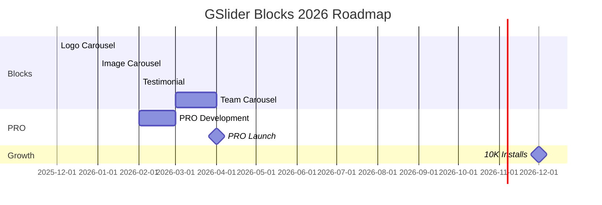

<p align="center">
  
</p>

<h1 align="center">GSlider Blocks</h1>

<p align="center">
  <strong>🎠 The Ultimate Gutenberg Carousel Collection</strong><br>
  10 Powerful Carousel Blocks for WordPress Block Editor
</p>

<p align="center">
  <a href="https://wordpress.org/plugins/gslider-blocks/">
    
  </a>
  <a href="https://php.net/">
    
  </a>
  <a href="http://www.gnu.org/licenses/gpl-2.0.html">
    
  </a>
  <a href="https://wordpress.org/plugins/gslider-blocks/">
    
  </a>
  <a href="https://wordpress.org/plugins/gslider-blocks/">
    
  </a>
  <a href="https://wordpress.org/plugins/gslider-blocks/">
    
  </a>
</p>

<p align="center">
  <a href="#-features">Features</a> •
  <a href="#-available-blocks">Blocks</a> •
  <a href="#-installation">Installation</a> •
  <a href="#-quick-start">Quick Start</a> •
  <a href="#-development">Development</a> •
  <a href="#-roadmap">Roadmap</a>
</p>

---

## 📖 About

**GSlider Blocks** brings beautiful, feature-rich carousel blocks to WordPress Gutenberg. Create stunning logo carousels, testimonials, image sliders, and more - all with an intuitive block editor interface. No coding required!

### Why GSlider Blocks?

| Feature | GSlider Blocks | Other Plugins |
|---------|:-------------:|:-------------:|
| Gutenberg Native | ✅ | ❌ Most use shortcodes |
| 10 Block Types | ✅ | ❌ Usually 1-2 |
| No jQuery | ✅ | ❌ Heavy dependencies |
| 7+ Effects | ✅ | ⚠️ Limited |
| 100% Free | ✅ | ⚠️ Freemium |

---

## ✨ Features

<table>
<tr>
<td width="50%">

### 🎨 Design & Effects
- **7+ Carousel Effects**
  - Slide, Fade, Cube
  - Coverflow, Flip, Cards
  - Creative
- **Hover Animations**
  - Grayscale-to-color
  - Opacity, Scale, Lift
- **Custom Navigation**
  - Icon picker
  - Custom images
- **Multiple Pagination**
  - Bullets, Fraction
  - Progressbar, Dynamic

</td>
<td width="50%">

### ⚡ Performance
- **Swiper.js Powered**
  - Hardware-accelerated
  - 60 FPS animations
- **Lazy Loading**
  - Optimized images
  - Faster page speed
- **Lightweight**
  - No jQuery
  - Minimal footprint
- **Clean Code**
  - Modern ES6+
  - React components

</td>
</tr>
<tr>
<td width="50%">

### 📱 Responsive
- **Device-Specific Settings**
  - Desktop, Tablet, Mobile
- **Touch/Swipe Support**
  - Mobile-friendly
- **Responsive Visibility**
  - Show/hide per device
- **Breakpoint Controls**
  - Custom breakpoints

</td>
<td width="50%">

### ♿ Accessibility
- **Keyboard Navigation**
  - Arrow keys, Tab
- **ARIA Labels**
  - Screen reader ready
- **Focus Management**
  - Proper focus states
- **Pause on Hover**
  - User control

</td>
</tr>
</table>

---

## 📦 Available Blocks

| # | Block | Description | Status |
|:-:|-------|-------------|:------:|
| 1 | 🎯 **Base Slider** | Hero sliders with Title, Subtitle, Description & CTA Button | ✅ Done |
| 2 | 📝 **Flexi Content** | Use ANY Gutenberg blocks inside slides | ✅ Done |
| 3 | 🏢 **Logo Carousel** | Client/partner logos with hover effects & tooltips | ✅ Done |
| 4 | 🖼️ **Image Carousel** | Beautiful image sliders with captions & lightbox | 🔨 Building |
| 5 | ⭐ **Testimonial Carousel** | Customer reviews with star ratings & avatars | 📋 Planned |
| 6 | 👥 **Team Carousel** | Team member profiles with social links | 📋 Planned |
| 7 | 🎥 **Video Carousel** | YouTube/Vimeo video sliders | 📋 Planned |
| 8 | 📊 **Stats Carousel** | Animated counters & achievements | 📋 Planned |
| 9 | 🏆 **Awards Carousel** | Certifications & awards display | 📋 Planned |
| 10 | 📰 **Post Carousel** | Dynamic blog posts slider | 📋 Planned |

### Block Features Comparison

```
┌─────────────────────────────────────────────────────────────────┐
│                        GSlider Blocks                           │
├──────────────┬──────────────┬──────────────┬───────────────────┤
│  Base Slider │ Flexi Content│Logo Carousel │  Image Carousel   │
├──────────────┼──────────────┼──────────────┼───────────────────┤
│ • Pre-built  │ • Any blocks │ • Logos      │ • Gallery         │
│   structure  │ • Full       │ • Hover FX   │ • Captions        │
│ • Title      │   creative   │ • Tooltips   │ • Links           │
│ • Subtitle   │   freedom    │ • Links      │ • Lightbox (PRO)  │
│ • Button     │ • InnerBlocks│ • Grayscale  │ • Lazy load       │
└──────────────┴──────────────┴──────────────┴───────────────────┘
```

---

## 📥 Installation

### From WordPress Admin (Recommended)

```bash
1. Go to Plugins → Add New
2. Search "GSlider Blocks"
3. Click Install Now → Activate
4. Done! 🎉
```

### Manual Installation

```bash
# Download from WordPress.org
wget https://downloads.wordpress.org/plugin/gslider-blocks.zip

# Unzip to plugins directory
unzip gslider-blocks.zip -d /wp-content/plugins/

# Activate via WP Admin or WP-CLI
wp plugin activate gslider-blocks
```

---

## 🎯 Quick Start

### 1️⃣ Base Slider (Hero Section)

```
┌────────────────────────────────────────┐
│  Add Block → Search "Base Slider"      │
│                ↓                        │
│  Add slides → Title, Description        │
│                ↓                        │
│  Set background image/color            │
│                ↓                        │
│  Configure autoplay & navigation       │
│                ↓                        │
│  Publish! ✅                            │
└────────────────────────────────────────┘
```

### 2️⃣ Logo Carousel (Client Showcase)

```
┌────────────────────────────────────────┐
│  Add Block → Search "Logo Carousel"    │
│                ↓                        │
│  Upload multiple client logos          │
│                ↓                        │
│  Set grayscale-to-color hover effect   │
│                ↓                        │
│  Add links & tooltips (optional)       │
│                ↓                        │
│  Publish! ✅                            │
└────────────────────────────────────────┘
```

### 3️⃣ Flexi Content (Custom Slides)

```
┌────────────────────────────────────────┐
│  Add Block → Search "Flexi Content"    │
│                ↓                        │
│  Add any blocks inside each slide      │
│  (Images, Text, Buttons, Galleries)    │
│                ↓                        │
│  Mix and match freely                  │
│                ↓                        │
│  Publish! ✅                            │
└────────────────────────────────────────┘
```

---

## 🛠️ Development

### Requirements

| Requirement | Version |
|-------------|---------|
| Node.js | ≥ 16.x |
| npm | ≥ 8.x |
| WordPress | ≥ 5.0 |
| PHP | ≥ 7.0 |

### Setup

```bash
# Clone repository
git clone https://github.com/noruzzamans/gslider-blocks.git
cd gslider-blocks

# Install dependencies
npm install

# Start development (watch mode)
npm run start

# Production build
npm run build

# Create release ZIP
npm run zip:package
```

### Project Structure

```
gslider-blocks/
│
├── 📁 src/                    # Source files
│   ├── 📁 blocks/             # Individual blocks
│   │   ├── 📁 base/           # Base Slider
│   │   ├── 📁 flexi-content/  # Flexi Content
│   │   ├── 📁 logo-carousel/  # Logo Carousel
│   │   └── 📁 image-slider/   # Image Carousel
│   ├── 📁 components/         # Shared React components
│   │   ├── color-control/
│   │   ├── icon-picker/
│   │   ├── responsive-range-control/
│   │   └── typography-control/
│   ├── 📁 constants/          # Constants & configs
│   └── 📁 utils/              # Utility functions
│
├── 📁 build/                  # Compiled assets
├── 📁 includes/               # PHP includes
├── 📁 admin/                  # Admin UI
├── 📁 languages/              # Translations
├── 📁 log/                    # Strategy & planning
│
├── 📄 gslider-blocks.php      # Main plugin file
├── 📄 readme.txt              # WordPress.org readme
├── 📄 package.json            # npm config
└── 📄 webpack.config.js       # Build config
```

---

## 🎨 Customization Options

### General Settings

| Category | Options |
|----------|---------|
| **Layout** | Slides per view (1-12), Gap, Height |
| **Animation** | Effect type, Speed, Direction |
| **Autoplay** | Enable/disable, Delay, Pause on hover |
| **Loop** | Infinite scroll, Stop at last |

### Navigation & Pagination

| Category | Options |
|----------|---------|
| **Arrows** | Show/hide, Icon picker, Custom image |
| **Position** | Inside/outside, 9 positions |
| **Pagination** | Bullets, Fraction, Progressbar |
| **Dots Style** | Size, Color, Active color |

### Styling

| Category | Options |
|----------|---------|
| **Background** | Color, Gradient, Image |
| **Border** | Width, Style, Radius, Shadow |
| **Typography** | Google Fonts, Size, Weight, Spacing |
| **Spacing** | Margin, Padding (responsive) |
| **Custom CSS** | Per-block custom styles |

---

## 📋 Roadmap

### 2026 Development Plan



### Quarterly Goals

| Quarter | Blocks | Installs Target | Milestones |
|---------|--------|-----------------|------------|
| **Q1** | Image, Testimonial | 1,500 | Documentation |
| **Q2** | Team, Video, Stats | 3,000 | **PRO Launch** 🚀 |
| **Q3** | Awards, Post | 6,000 | WooCommerce Integration |
| **Q4** | Before/After | 10,000+ | Lifetime Deals |

---

## 💰 Free vs PRO

| Feature | Free | PRO |
|---------|:----:|:---:|
| 10 Carousel Blocks | ✅ | ✅ |
| 7+ Carousel Effects | ✅ | ✅ |
| Responsive Controls | ✅ | ✅ |
| Custom Navigation Icons | ✅ | ✅ |
| Touch/Swipe Support | ✅ | ✅ |
| Keyboard Navigation | ✅ | ✅ |
| **Lightbox Integration** | ❌ | ✅ |
| **Pre-built Templates (20+)** | ❌ | ✅ |
| **Dynamic Content (ACF/CPT)** | ❌ | ✅ |
| **WooCommerce Integration** | ❌ | ✅ |
| **Advanced Hover Effects** | ❌ | ✅ |
| **Categories & Filtering** | ❌ | ✅ |
| **White Label** | ❌ | ✅ |
| **Priority Support** | ❌ | ✅ |

### PRO Pricing (Coming Q2 2026)

| Plan | Price | Sites |
|------|-------|-------|
| **PRO** | $49/year | 1 site |
| **Agency** | $149/year | Unlimited |
| **Lifetime** | $299 | Forever |

---

## 🤝 Contributing

We welcome contributions! Here's how you can help:

### Ways to Contribute

- 🐛 **Report Bugs** - Open an issue
- 💡 **Suggest Features** - Open a discussion
- 🔧 **Submit PRs** - Fix bugs or add features
- 📖 **Improve Docs** - Help with documentation
- ⭐ **Star the Repo** - Show your support!

### Development Workflow

```bash
# 1. Fork the repository
# 2. Create feature branch
git checkout -b feature/amazing-feature

# 3. Make changes
npm run start  # Development mode

# 4. Test your changes
npm run build

# 5. Commit with conventional commits
git commit -m "feat: add amazing feature"

# 6. Push and create PR
git push origin feature/amazing-feature
```

---

## 📞 Support

| Channel | Link |
|---------|------|
| 📧 Email | [noruzzaman19@gmail.com](mailto:noruzzaman19@gmail.com) |
| 🐛 GitHub Issues | [Report Bug](https://github.com/noruzzamans/gslider-blocks/issues) |
| 💬 WordPress Forum | [Support Forum](https://wordpress.org/support/plugin/gslider-blocks/) |
| 📖 Documentation | Coming Soon |

---

## 📄 License

This project is licensed under the **GPLv2 or later**.

```
GSlider Blocks - WordPress Plugin
Copyright (C) 2025-2026 Noruzzaman

This program is free software; you can redistribute it and/or modify
it under the terms of the GNU General Public License as published by
the Free Software Foundation; either version 2 of the License, or
(at your option) any later version.
```

---

## 👨‍💻 Author

<p align="center">
  
</p>

<p align="center">
  <strong>Noruzzaman</strong><br>
  WordPress Developer | Open Source Contributor
</p>

<p align="center">
  <a href="https://github.com/noruzzamans">
    
  </a>
  <a href="https://linkedin.com/in/noruzzaman">
    
  </a>
  <a href="https://wordpress.org/plugins/gslider-blocks/">
    
  </a>
</p>

---

## 🙏 Credits

- [Swiper.js](https://swiperjs.com/) - Modern touch slider library
- [WordPress](https://wordpress.org/) - The world's best CMS
- [React](https://reactjs.org/) - UI component library
- [Google Fonts](https://fonts.google.com/) - Typography

---

<p align="center">
  <strong>⭐ If you find GSlider Blocks useful, please give it a star on GitHub!</strong>
</p>

<p align="center">
  <a href="https://wordpress.org/plugins/gslider-blocks/">
    
  </a>
</p>

<p align="center">
  Made with ❤️ for the WordPress Community
</p>
