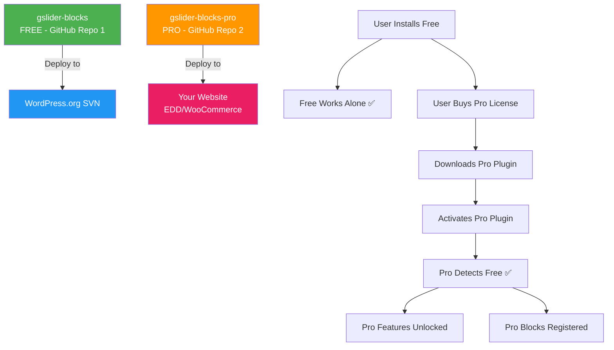

# GSlider Blocks Pro — Architecture Overview & Strategy

## 📌 1. The Big Picture: How Free + Pro Works in WordPress

### The Industry-Standard Pattern: "Addon on Top of Free"

Every major WordPress Gutenberg block plugin (Spectra, Essential Blocks, Starter Templates, Kadence Blocks, Stackable, etc.) follows the **same proven pattern**:

```
📦 Free Plugin (wp.org)           📦 Pro Plugin (your website)
├── gslider-blocks/                ├── gslider-blocks-pro/
│   ├── gslider-blocks.php         │   ├── gslider-blocks-pro.php
│   ├── includes/                  │   ├── includes/
│   ├── src/                       │   ├── src/
│   └── build/                     │   └── build/
│                                  │
│  ✅ Lives on wp.org              │  ❌ NOT on wp.org
│  ✅ Fully functional alone       │  ❌ REQUIRES free plugin
│  ✅ GPL Licensed                 │  ✅ GPL Licensed + License Key
```

### Key Principles

1. **Free plugin is a SEPARATE, INDEPENDENT plugin** — it works perfectly alone, without pro
2. **Pro plugin is a SEPARATE plugin** — it extends the free plugin (like an "addon")
3. **Pro plugin REQUIRES the free plugin** — it checks if free is active before loading
4. **Pro plugin is NEVER on wp.org** — sold/distributed from your own website
5. **Both are GPL licensed** — but pro has a license key for updates + support access

### Why Separate Plugins (Not Feature Flags)?

| Approach | Pros | Cons |
|----------|------|------|
| **Separate Addon Plugin** ✅ | wp.org compliant, clean code separation, independent updates, easy to maintain | Two repos to manage |
| Feature Flags (single plugin) ❌ | Single codebase | **Violates wp.org rules**, bloated free version, confusing code |
| Freemius SDK (single plugin) ⚠️ | All-in-one solution | Adds SDK bloat, vendor lock-in, revenue share |

> [!WARNING]
> **wp.org Rule**: The free plugin on wp.org **MUST NOT** contain locked/disabled premium features. Pro code must live in a separate plugin entirely.

---

## 📌 2. How Real Plugins Do It

### Spectra (by Brainstorm Force)

```
wp-content/plugins/
├── ultimate-addons-for-gutenberg/     ← FREE (wp.org)
│   ├── ultimate-addons-for-gutenberg.php
│   ├── blocks/
│   ├── includes/
│   └── classes/
│       ├── class-uagb-loader.php
│       └── class-uagb-init-blocks.php
│
├── spectra-pro/                        ← PRO (their website)
│   ├── spectra-pro.php
│   ├── blocks/                         ← Pro-only blocks
│   ├── includes/
│   │   ├── class-spectra-pro-loader.php
│   │   └── class-spectra-pro-license.php
│   └── extensions/                     ← Extensions to free blocks
│       ├── dynamic-content/
│       └── popup-builder/
```

**How they connect:**
- Free plugin fires **action hooks** → `do_action('spectra_after_init')`
- Pro plugin **hooks into free** → `add_action('spectra_after_init', ...)`
- Free blocks use **filter hooks** → `apply_filters('spectra_block_attributes', $attrs)`
- Pro plugin **adds pro attributes** through those filters

### Essential Blocks (by WPDevelers)

```
wp-content/plugins/
├── essential-blocks/                   ← FREE (wp.org)
│   ├── essential-blocks.php
│   ├── blocks/
│   └── includes/
│       └── class-essential-blocks.php
│
├── essential-blocks-pro/               ← PRO (their website)
│   ├── essential-blocks-pro.php        ← Checks if free is active
│   ├── blocks/                         ← Pro-only blocks
│   └── includes/
│       ├── class-eb-pro-blocks.php
│       └── class-eb-pro-license.php
```

**Key Pattern:**
- Pro checks: `if (!class_exists('EssentialBlocks'))` → show admin notice "Install free version first"
- Pro blocks registered alongside free blocks
- Pro features added to free blocks via `wp.hooks.addFilter()` in JavaScript

---

## 📌 3. What Goes Where (Free vs Pro)

### For YOUR Plugin (gslider-blocks)

| Feature Type | Where It Lives | Example |
|-------------|---------------|---------|
| **Existing free blocks** | Free plugin | Base Slider, Image Slider, Logo Carousel, Flexi Content, Testimonial |
| **Basic controls for free blocks** | Free plugin | Arrows, dots, autoplay, speed, colors |
| **Advanced controls for existing blocks** | **Pro plugin** ✅ | Advanced animations, conditional display, dynamic content |
| **New pro-only blocks** | **Pro plugin** ✅ | Before/After Slider, Video Slider, Product Carousel |
| **Pro-only templates/patterns** | **Pro plugin** ✅ | Pre-built slider designs |
| **License management** | **Pro plugin** ✅ | License key check, auto-updates |
| **Core utilities/helpers** | Free plugin | Swiper, fonts, style generator |
| **Upsell notices** | Free plugin | "Upgrade to Pro" badges in editor (NOT locked features) |

### Decision Rule for New Features:

```
Is this feature FREE or PRO?
│
├── Is it a basic, essential feature that most users need?
│   └── YES → FREE plugin
│
├── Is it an advanced feature that power users/agencies want?
│   └── YES → PRO plugin
│
├── Is it a whole new block?
│   ├── Basic slider-type block → Could be FREE (for growth)
│   └── Advanced/specialized block → PRO plugin
│
└── Does it extend an existing free block?
    └── YES → PRO plugin (via hooks)
```

---

## 📌 4. Communication Between Free & Pro

### The Hook System (Most Critical Part!)

The **free plugin** must expose hooks (actions + filters) so the **pro plugin** can extend it **without modifying free plugin code**.

#### PHP Hooks (Server Side)

```php
// FREE PLUGIN: gslider-blocks.php / Plugin.php
// Fire action hooks that Pro can listen to

class Plugin {
    public function plugins_loaded() {
        // ... existing code ...
        
        // 🔌 Hook for Pro plugin to initialize
        do_action('gslider_loaded');
        do_action('gslider_after_init');
    }
}

// FREE PLUGIN: RegistrationBlocks.php
// Fire filters so Pro can register additional blocks

class RegistrationBlocks {
    public function register() {
        $blocks = $this->get_blocks();
        
        // 🔌 Filter: Pro plugin can add its own blocks here
        $blocks = apply_filters('gslider_registered_blocks', $blocks);
        
        foreach ($blocks as $block) {
            register_block_type($block);
        }
    }
}

// FREE PLUGIN: Individual block render
// Allow Pro to modify block output

function render_block($attributes, $content) {
    // ... render logic ...
    
    // 🔌 Filter: Pro can modify rendered HTML
    $output = apply_filters('gslider_block_output', $output, $attributes, $block_name);
    
    return $output;
}
```

#### JavaScript Hooks (Editor Side)

```javascript
// FREE PLUGIN: Inside a block's edit.js
// Allow Pro to add inspector controls

import { addFilter } from '@wordpress/hooks';
import { createHigherOrderComponent } from '@wordpress/compose';

// FREE: Fire a slot/filter for pro controls
const inspectorControls = applyFilters(
    'gslider.inspectorControls',
    <></>,  // default: empty
    attributes,
    setAttributes
);

// PRO PLUGIN: pro-extensions.js
// Add extra controls to free block
addFilter(
    'gslider.inspectorControls',
    'gslider-pro/advanced-controls',
    (controls, attributes, setAttributes) => {
        return (
            <>
                {controls}
                <PanelBody title="Pro Settings">
                    {/* Pro controls here */}
                </PanelBody>
            </>
        );
    }
);
```

#### JavaScript Block Attribute Extension

```javascript
// PRO PLUGIN: extend free block attributes
addFilter(
    'blocks.registerBlockType',
    'gslider-pro/extend-attributes',
    (settings, name) => {
        if (name === 'gslider/base-slider') {
            settings.attributes = {
                ...settings.attributes,
                // Add pro-only attributes
                enableParallax: { type: 'boolean', default: false },
                customAnimation: { type: 'string', default: 'fade' },
            };
        }
        return settings;
    }
);
```

---

## 📌 5. Development & Deployment Workflow



### Repository Structure

```
GitHub:
├── noruzzamans/gslider-blocks          ← FREE plugin repo
│   └── (current code)
│
├── noruzzamans/gslider-blocks-pro      ← PRO plugin repo (NEW)
│   └── (pro-only code)
```

---

## 📌 6. The Pro User Journey

```
Step 1: User finds "GSlider Blocks" on wp.org
         └── Installs free version
         
Step 2: User uses free blocks (slider, carousel, etc.)
         └── Sees "Pro" badge on certain controls
         └── Sees "Upgrade to Pro" link (NOT locked features)
         
Step 3: User visits gslider-blocks.com (your website)
         └── Sees pricing plans
         └── Purchases license
         
Step 4: Downloads gslider-blocks-pro.zip from your site
         └── Uploads to WordPress
         └── Activates
         
Step 5: Enters license key in Settings page
         └── License validated via API
         └── Pro features now active
         └── Receives automatic updates
```

---

## 📌 7. Revenue Model Options

| Plan | Price Range | Includes |
|------|------------|----------|
| **Personal** | $39-49/year | 1 site, pro blocks, pro features, 1 year updates/support |
| **Business** | $79-99/year | 5 sites, everything in Personal |
| **Agency** | $149-199/year | Unlimited sites, everything in Business, priority support |
| **Lifetime** | $199-299 one-time | Unlimited sites, lifetime updates |

> [!TIP]
> Most successful WordPress plugins start with 3 tiers (Personal, Business, Agency). Add Lifetime later when you have an established product.
