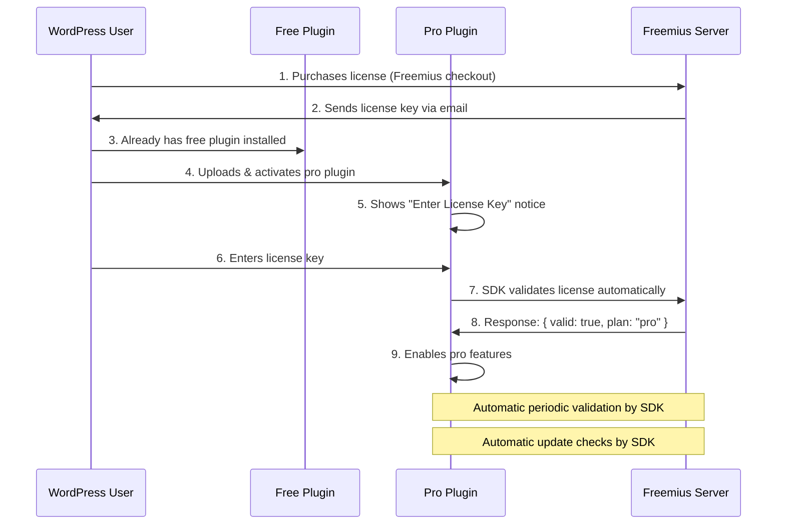

# GSlider Blocks Pro — License Management System (Freemius)

## ✅ Setup Progress (Updated: 2026-02-17)

### Completed
- [x] Created Freemius account (noruzzaman19@gmail.com — Verified)
- [x] PayPal payout method configured (USD)
- [x] Created Store: **GSlider** (gsliderblocks.com)
- [x] Created Product: **GSlider Blocks Pro** (slug: `gslider-blocks-pro`)
  - Type: WordPress Plugin
  - Monetization: Paid plan(s)
  - Free plan: Yes (toggle ON)
  - Analytics: Enabled
  - Sell through Freemius: Enabled
- [x] Created **Personal** plan (Annual: $29, Lifetime: $79, 1 site)
- [/] Creating **Business** plan (Annual: $49, Lifetime: $129, 5 sites) ⭐ Popular

### Pending
- [ ] Create **Agency** plan (Annual: $99, Lifetime: $199, Unlimited sites)
- [ ] Set star on Business plan (Popular badge)
- [ ] Release plans to users
- [ ] Set up refund policy
- [ ] SDK Integration (download SDK, add to pro plugin)
- [ ] Upload first plugin version to Freemius

---

## 📌 1. Why Freemius

| Feature | Details |
|---------|---------|
| **Pricing** | 7% revenue share (decreasing with volume) |
| **Model** | Revenue sharing — they handle everything |
| **Best For** | Developers who want all-in-one (checkout + licensing + updates) |
| **Key Features** | Checkout, licensing, updates, affiliate system, cart recovery |
| **Integration** | Built-in checkout (they are merchant of record) |
| **Auto Updates** | ✅ Built-in |
| **Analytics** | ✅ Good |
| **SDK** | Feature-rich PHP SDK |
| **Upfront Cost** | 💰 **$0** — No investment needed to start |

> [!IMPORTANT]
> **Freemius is the best choice for zero-budget starts:**
> 1. No upfront cost — 0 tk invest
> 2. They handle payment processing, tax, invoicing
> 3. Built-in checkout page (no need for your own website initially)
> 4. SDK handles everything: licensing, updates, analytics
> 5. Affiliate system built-in for marketing
> 6. Cart abandonment recovery to boost sales

---

## 📌 2. How License Management Works (Technical Flow)



---

## 📌 3. Freemius SDK Integration

### Step 1: Create Account & Add Product

1. Go to [freemius.com](https://freemius.com) — Create free account
2. Add your plugin as a product
3. Set up pricing plans
4. Get your plugin ID and public key

### Step 2: Install SDK

Download the Freemius SDK and place it in your pro plugin:

```
gslider-blocks-pro/
├── freemius/          ← Freemius SDK folder
│   ├── start.php
│   ├── includes/
│   └── ...
├── gslider-blocks-pro.php
└── ...
```

### Step 3: Initialize in Pro Plugin

```php
<?php
// PRO PLUGIN: gslider-blocks-pro.php

/**
 * Initialize Freemius SDK.
 */
function gslider_pro_fs() {
    global $gslider_pro_fs;

    if ( ! isset( $gslider_pro_fs ) ) {
        // Include Freemius SDK
        require_once dirname(__FILE__) . '/freemius/start.php';

        $gslider_pro_fs = fs_dynamic_init( array(
            'id'               => 'YOUR_PLUGIN_ID',       // From Freemius dashboard
            'slug'             => 'gslider-blocks-pro',
            'type'             => 'plugin',
            'public_key'       => 'YOUR_PUBLIC_KEY',       // From Freemius dashboard
            'is_premium'       => true,
            'is_premium_only'  => true,
            'has_addons'       => false,
            'has_paid_plans'   => true,
            'menu'             => array(
                'slug'    => 'gslider-pro-license',
                'parent'  => array(
                    'slug' => 'gslider-blocks',            // Under GSlider menu
                ),
            ),
        ) );
    }

    return $gslider_pro_fs;
}

// Initialize Freemius
gslider_pro_fs();

// Signal that SDK was initiated
do_action( 'gslider_pro_fs_loaded' );

// Check license and enable features
if ( gslider_pro_fs()->is_paying() ) {
    define('GSLIDER_PRO_ACTIVE', true);
    // Load pro features
    require_once __DIR__ . '/includes/Plugin.php';
}
```

> [!TIP]
> **Freemius SDK handles automatically:**
> - License key entry page (UI) ✅
> - License activation/deactivation ✅
> - License validation (periodic) ✅
> - Auto-updates ✅
> - Usage analytics ✅
> - Deactivation feedback modal ✅
> - Checkout page (hosted by Freemius) ✅
> - Payment processing + tax ✅
> - Subscription management ✅
>
> **You just focus on building the pro features!**

---

## 📌 4. Freemius Helper Functions

```php
<?php
// Check if user has valid pro license
function gslider_is_pro_licensed() {
    return function_exists('gslider_pro_fs') && gslider_pro_fs()->is_paying();
}

// Check specific plan
function gslider_is_plan( $plan_name ) {
    if ( ! function_exists('gslider_pro_fs') ) {
        return false;
    }
    return gslider_pro_fs()->is_plan( $plan_name );
}

// Example usage in pro plugin
if ( gslider_is_pro_licensed() ) {
    // Enable pro features
}

// Plan-based features
if ( gslider_is_plan('agency') ) {
    // Agency-only features like white labeling
}
```

---

## 📌 5. Competitor Analysis & Pricing Strategy

### GutSlider (gutslider.com) — Direct Competitor

**Yearly Pricing:**

| Plan | Original | Discounted | Sites |
|------|----------|------------|-------|
| Personal | ~~$49~~ | **$29**/year | 1 site |
| Popular | ~~$99~~ | **$49**/year | 10 sites |
| Agency | ~~$199~~ | **$99**/year | 1000 sites |

**Lifetime Pricing:**

| Plan | Original | Discounted | Sites |
|------|----------|------------|-------|
| Personal | ~~$199~~ | **$99** | 1 site |
| Popular | ~~$299~~ | **$149** | 10 sites |
| Agency | ~~$399~~ | **$199** | 1000 sites |

**GutSlider Pro Features:**
- 10+ Pro Slider & Carousel
- 3D Slider & 3D Carousel
- 25+ Content Animations
- Dynamic Slider & Carousel
- 1 Year Support & Update (Yearly) / Lifetime Support & Update (Lifetime)

---

### Our Pricing (GSlider Blocks Pro)

**Yearly Pricing:**

| Plan | Original | Discounted | Sites |
|------|----------|------------|-------|
| Personal | ~~$49~~ | **$29**/year | 1 site |
| Business | ~~$79~~ | **$49**/year | 5 sites |
| Agency | ~~$149~~ | **$99**/year | Unlimited |

**Lifetime Pricing:**

| Plan | Original | Discounted | Sites |
|------|----------|------------|-------|
| Personal | ~~$149~~ | **$79** | 1 site |
| Business | ~~$199~~ | **$129** | 5 sites |
| Agency | ~~$299~~ | **$199** | Unlimited |

**Our Competitive Advantages vs GutSlider:**
- ✅ **Unlimited sites** on Agency (GutSlider gives 1000)
- ✅ Lower lifetime pricing
- ✅ Launch discount (40% off first year)

> [!TIP]
> **Launch Strategy:**
> - Offer lifetime deals early to get initial users and reviews
> - Run a 40% launch discount for first 3 months
> - Focus on unique features GutSlider doesn't have

---

## 📌 6. Free Plugin Freemius Integration (Optional)

You can also add Freemius SDK to the **free plugin** on wp.org for analytics and in-dashboard upgrade prompts:

```php
<?php
// FREE PLUGIN: gslider-blocks.php (optional)

function gslider_fs() {
    global $gslider_fs;

    if ( ! isset( $gslider_fs ) ) {
        require_once dirname(__FILE__) . '/freemius/start.php';

        $gslider_fs = fs_dynamic_init( array(
            'id'               => 'YOUR_FREE_PLUGIN_ID',
            'slug'             => 'gslider-blocks',
            'type'             => 'plugin',
            'public_key'       => 'YOUR_FREE_PUBLIC_KEY',
            'is_premium'       => false,
            'has_addons'       => true,     // Pro is an addon
            'has_paid_plans'   => false,
            'menu'             => array(
                'slug' => 'gslider-blocks',
            ),
        ) );
    }

    return $gslider_fs;
}

gslider_fs();
```

> [!CAUTION]
> Adding Freemius SDK to the free plugin is **optional**. Some wp.org reviewers may ask questions about SDK data collection. You can always add it later after the pro plugin is ready.
