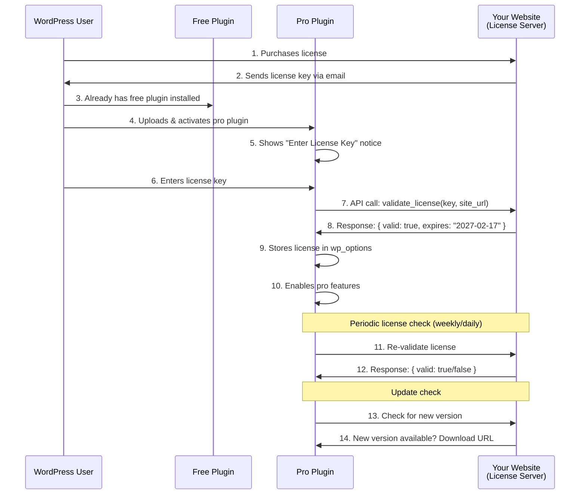

# GSlider Blocks Pro — License Management System

## 📌 1. License Management Options Comparison

### Option A: Appsero (⭐ RECOMMENDED for You)

| Feature | Details |
|---------|---------|
| **Pricing** | Free for unlimited free plugins; Paid from ~$20/month for 500 licenses |
| **Model** | Fixed monthly fee (NOT revenue share) |
| **Best For** | WordPress plugin developers, especially Bangladeshi developers |
| **Company** | weDevs (Bangladeshi company — support in your timezone!) |
| **Key Features** | License management, auto-deployment from GitHub, analytics, deactivation feedback |
| **Integration** | WooCommerce, EDD, Paddle, FastSpring |
| **Auto Updates** | ✅ Built-in |
| **Analytics** | ✅ Excellent — shows active installs, PHP versions, WP versions |
| **SDK** | Lightweight PHP SDK you include in your plugin |

### Option B: Freemius

| Feature | Details |
|---------|---------|
| **Pricing** | 7% revenue share (decreasing with volume) |
| **Model** | Revenue sharing — they handle everything |
| **Best For** | Developers who want all-in-one (checkout + licensing + updates) |
| **Company** | Israeli startup |
| **Key Features** | Checkout, licensing, updates, affiliate system, cart recovery |
| **Integration** | Built-in checkout (they are merchant of record) |
| **Auto Updates** | ✅ Built-in |
| **Analytics** | ✅ Good |
| **SDK** | Heavier SDK, more feature-rich |

### Option C: Easy Digital Downloads (EDD) + Software Licensing

| Feature | Details |
|---------|---------|
| **Pricing** | EDD: Free or $99/year; Software Licensing addon: $99.50/year |
| **Model** | Self-hosted — you run your own licensing server |
| **Best For** | Full control, no revenue sharing |
| **Company** | US-based |
| **Key Features** | Full e-commerce, license keys, renewal management |
| **Integration** | Self-hosted on your WordPress site |
| **Auto Updates** | ✅ Via EDD Software Licensing |
| **Analytics** | Basic |
| **SDK** | You implement the updater class yourself |

### Option D: WooCommerce + License Manager Plugin

| Feature | Details |
|---------|---------|
| **Pricing** | WooCommerce: Free; License Manager: $49-99/year |
| **Model** | Self-hosted |
| **Best For** | If you already use WooCommerce |

### My Recommendation

> [!IMPORTANT]
> **Start with Appsero** for these reasons:
> 1. Fixed pricing (not revenue share) — better when starting out
> 2. Bangladeshi company (weDevs) — support in your timezone and language
> 3. GitHub deployment integration — push to GitHub → auto-deploy to your site
> 4. Lightweight SDK — minimal overhead
> 5. Free tier for unlimited free plugins
> 6. Excellent analytics dashboard
> 7. Easy setup with WooCommerce for selling

---

## 📌 2. How License Management Works (Technical Flow)



---

## 📌 3. License Code Implementation

### Overview of Files

```
gslider-blocks-pro/
├── includes/
│   └── License/
│       ├── LicenseManager.php    ← Core logic
│       ├── LicenseAPI.php        ← Server communication
│       ├── LicenseAdmin.php      ← Settings page UI
│       └── Updater.php           ← Plugin auto-updater
```

### LicenseManager.php

```php
<?php
namespace GSliderPro\License;

class LicenseManager {
    
    const OPTION_KEY = 'gslider_pro_license';
    const STATUS_KEY = 'gslider_pro_license_status';
    
    /**
     * Get the stored license key.
     */
    public function get_license_key() {
        return get_option(self::OPTION_KEY, '');
    }
    
    /**
     * Get the license status.
     * 
     * @return string 'valid', 'invalid', 'expired', 'inactive', ''
     */
    public function get_status() {
        return get_option(self::STATUS_KEY, '');
    }
    
    /**
     * Check if the license is valid and active.
     */
    public function is_valid() {
        return $this->get_status() === 'valid';
    }
    
    /**
     * Activate a license key.
     * 
     * @param string $key License key to activate.
     * @return array Result with 'success' and 'message'.
     */
    public function activate($key) {
        $api = new LicenseAPI();
        $result = $api->activate_license($key, home_url());
        
        if ($result['success']) {
            update_option(self::OPTION_KEY, sanitize_text_field($key));
            update_option(self::STATUS_KEY, 'valid');
            update_option('gslider_pro_license_data', $result['data']);
        }
        
        return $result;
    }
    
    /**
     * Deactivate the current license.
     */
    public function deactivate() {
        $key = $this->get_license_key();
        $api = new LicenseAPI();
        $api->deactivate_license($key, home_url());
        
        delete_option(self::OPTION_KEY);
        delete_option(self::STATUS_KEY);
        delete_option('gslider_pro_license_data');
        
        return true;
    }
    
    /**
     * Periodic validation (cron job or admin_init).
     */
    public function validate_periodically() {
        $last_check = get_option('gslider_pro_license_last_check', 0);
        
        // Check every 24 hours
        if (time() - $last_check < DAY_IN_SECONDS) {
            return;
        }
        
        $key = $this->get_license_key();
        if (empty($key)) {
            return;
        }
        
        $api = new LicenseAPI();
        $result = $api->check_license($key, home_url());
        
        update_option(self::STATUS_KEY, $result['status'] ?? 'invalid');
        update_option('gslider_pro_license_last_check', time());
    }
}
```

### LicenseAdmin.php (Settings Page)

```php
<?php
namespace GSliderPro\License;

class LicenseAdmin {
    
    public function register() {
        add_action('admin_menu', [$this, 'add_settings_page']);
        add_action('admin_init', [$this, 'handle_license_actions']);
        add_action('admin_notices', [$this, 'license_notices']);
    }
    
    /**
     * Add license settings page under GSlider menu.
     */
    public function add_settings_page() {
        add_submenu_page(
            'gslider-blocks',              // Parent menu slug
            __('License', 'gslider-blocks-pro'),
            __('License', 'gslider-blocks-pro'),
            'manage_options',
            'gslider-pro-license',
            [$this, 'render_page']
        );
    }
    
    /**
     * Render the license settings page.
     */
    public function render_page() {
        $manager = new LicenseManager();
        $key = $manager->get_license_key();
        $status = $manager->get_status();
        $data = get_option('gslider_pro_license_data', []);
        
        ?>
        <div class="wrap">
            <h1><?php _e('GSlider Blocks Pro — License', 'gslider-blocks-pro'); ?></h1>
            
            <form method="post" action="">
                <?php wp_nonce_field('gslider_pro_license_action'); ?>
                
                <table class="form-table">
                    <tr>
                        <th><?php _e('License Key', 'gslider-blocks-pro'); ?></th>
                        <td>
                            <input 
                                type="password" 
                                name="gslider_pro_license_key" 
                                value="<?php echo esc_attr($key); ?>"
                                class="regular-text"
                                <?php echo $status === 'valid' ? 'readonly' : ''; ?>
                            />
                            <?php if ($status === 'valid'): ?>
                                <span style="color: green;">✅ <?php _e('Active', 'gslider-blocks-pro'); ?></span>
                            <?php elseif ($status === 'expired'): ?>
                                <span style="color: orange;">⚠️ <?php _e('Expired', 'gslider-blocks-pro'); ?></span>
                            <?php elseif ($status === 'invalid'): ?>
                                <span style="color: red;">❌ <?php _e('Invalid', 'gslider-blocks-pro'); ?></span>
                            <?php endif; ?>
                        </td>
                    </tr>
                    
                    <?php if ($status === 'valid' && !empty($data)): ?>
                    <tr>
                        <th><?php _e('Expires', 'gslider-blocks-pro'); ?></th>
                        <td><?php echo esc_html($data['expires'] ?? 'N/A'); ?></td>
                    </tr>
                    <tr>
                        <th><?php _e('Activations', 'gslider-blocks-pro'); ?></th>
                        <td>
                            <?php echo esc_html(($data['activations'] ?? 0) . ' / ' . ($data['max_activations'] ?? 'Unlimited')); ?>
                        </td>
                    </tr>
                    <?php endif; ?>
                </table>
                
                <?php if ($status === 'valid'): ?>
                    <input type="submit" name="gslider_deactivate_license" 
                           class="button" value="<?php _e('Deactivate License', 'gslider-blocks-pro'); ?>" />
                <?php else: ?>
                    <input type="submit" name="gslider_activate_license" 
                           class="button button-primary" value="<?php _e('Activate License', 'gslider-blocks-pro'); ?>" />
                <?php endif; ?>
            </form>
        </div>
        <?php
    }
    
    /**
     * Handle license activation/deactivation form submission.
     */
    public function handle_license_actions() {
        if (!current_user_can('manage_options')) {
            return;
        }
        
        $manager = new LicenseManager();
        
        if (isset($_POST['gslider_activate_license'])) {
            check_admin_referer('gslider_pro_license_action');
            $key = sanitize_text_field($_POST['gslider_pro_license_key'] ?? '');
            $result = $manager->activate($key);
            
            if (!$result['success']) {
                add_settings_error('gslider_pro', 'license_error', $result['message'], 'error');
            }
        }
        
        if (isset($_POST['gslider_deactivate_license'])) {
            check_admin_referer('gslider_pro_license_action');
            $manager->deactivate();
        }
    }
    
    /**
     * Show admin notice if license is not active.
     */
    public function license_notices() {
        $manager = new LicenseManager();
        
        if (!$manager->is_valid()) {
            echo '<div class="notice notice-warning is-dismissible">';
            echo '<p>';
            printf(
                __('GSlider Blocks Pro requires a valid license key. %sEnter your license key%s to unlock pro features and receive automatic updates.', 'gslider-blocks-pro'),
                '<a href="' . admin_url('admin.php?page=gslider-pro-license') . '">',
                '</a>'
            );
            echo '</p>';
            echo '</div>';
        }
    }
}
```

### Updater.php (Auto-Updates from Your Server)

```php
<?php
namespace GSliderPro\License;

class Updater {
    
    private $plugin_file;
    private $plugin_slug;
    private $version;
    private $api_url;
    
    public function __construct() {
        $this->plugin_file = GSLIDER_PRO_FILE;
        $this->plugin_slug = 'gslider-blocks-pro';
        $this->version = GSLIDER_PRO_VERSION;
        $this->api_url = 'https://your-website.com/wp-json/gslider/v1/';
    }
    
    public function register() {
        add_filter('pre_set_site_transient_update_plugins', [$this, 'check_update']);
        add_filter('plugins_api', [$this, 'plugin_info'], 10, 3);
        add_action('in_plugin_update_message-' . plugin_basename($this->plugin_file), [$this, 'update_message']);
    }
    
    /**
     * Check for plugin updates.
     */
    public function check_update($transient) {
        if (empty($transient->checked)) {
            return $transient;
        }
        
        $manager = new LicenseManager();
        if (!$manager->is_valid()) {
            return $transient;
        }
        
        $remote = $this->get_remote_version();
        
        if ($remote && version_compare($this->version, $remote->version, '<')) {
            $plugin_file = plugin_basename($this->plugin_file);
            
            $transient->response[$plugin_file] = (object) [
                'slug'        => $this->plugin_slug,
                'new_version' => $remote->version,
                'url'         => $remote->homepage ?? '',
                'package'     => $remote->download_url ?? '',
                'tested'      => $remote->tested ?? '',
                'requires'    => $remote->requires ?? '',
            ];
        }
        
        return $transient;
    }
    
    /**
     * Get remote version info from your server.
     */
    private function get_remote_version() {
        $manager = new LicenseManager();
        $key = $manager->get_license_key();
        
        $response = wp_remote_get(
            add_query_arg([
                'license_key' => $key,
                'site_url'    => home_url(),
                'version'     => $this->version,
            ], $this->api_url . 'update-check'),
            ['timeout' => 10]
        );
        
        if (is_wp_error($response) || wp_remote_retrieve_response_code($response) !== 200) {
            return false;
        }
        
        return json_decode(wp_remote_retrieve_body($response));
    }
}
```

---

## 📌 4. Using Appsero SDK (Simplified Approach)

If you use **Appsero**, most of the above code is replaced by their SDK:

```php
<?php
// PRO PLUGIN: gslider-blocks-pro.php

// Include Appsero SDK (via Composer)
require_once __DIR__ . '/vendor/autoload.php';

/**
 * Initialize Appsero tracker and licensing.
 */
function gslider_pro_init_appsero() {
    $client = new \Appsero\Client(
        'your-appsero-hash-key',            // From Appsero dashboard
        'GSlider Blocks Pro',                // Product name
        __FILE__                             // Plugin file
    );
    
    // Enable insights (anonymous usage data)
    $client->insights()->init();
    
    // Enable license management
    $client->license()
        ->set_option_key('gslider_pro_license')
        ->add_settings_page([
            'parent_slug' => 'gslider-blocks',     // Under GSlider menu
            'page_title'  => 'License',
            'menu_title'  => 'License',
        ]);
    
    // Enable auto-updates
    $client->updater();
    
    // Check license and enable features
    if ($client->license()->is_valid()) {
        define('GSLIDER_PRO_ACTIVE', true);
        // Load pro features
        require_once __DIR__ . '/includes/Plugin.php';
    }
}
add_action('plugins_loaded', 'gslider_pro_init_appsero');
```

> [!TIP]
> **Appsero SDK handles**:
> - License key entry page (UI)
> - License activation/deactivation
> - License validation
> - Auto-updates from your server
> - Usage analytics
> - Deactivation feedback
> 
> **You just focus on building the pro features!**

---

## 📌 5. Where to Sell Licenses

### Option A: Your Own Website with WooCommerce + Appsero

```
your-website.com (WordPress site)
├── WooCommerce (free)
│   └── Product: "GSlider Blocks Pro"
│       ├── Personal License  — $39/year  — 1 site
│       ├── Business License  — $79/year  — 5 sites
│       └── Agency License    — $149/year — Unlimited sites
│
├── Appsero Integration
│   └── WooCommerce → Appsero (auto-generates license keys)
│   └── Appsero → Pro Plugin (validates license)
```

### Option B: Gumroad / LemonSqueezy (Simpler Start)

| Platform | Fees | Pros | Cons |
|----------|------|------|------|
| LemonSqueezy | 5% + payment fees | Built-in tax handling, easy setup | Less WordPress-specific |
| Gumroad | 10% | Very simple | High fees |
| Your WooCommerce | Payment gateway fees only (~2.9%) | Full control, lowest fees | More setup work |

> [!IMPORTANT]
> **For a WordPress plugin**, WooCommerce + Appsero on your own site is the best approach because:
> 1. Lowest ongoing costs
> 2. Full control over customer data
> 3. Appsero handles the license ↔ WooCommerce connection automatically
> 4. Professional WordPress product website
