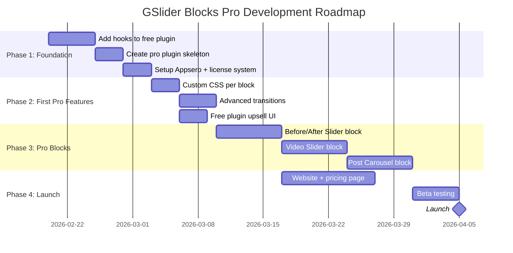

# GSlider Blocks Pro — Development Roadmap & Action Steps

## 📌 Phase Overview

---

## 📌 Phase 1: Foundation (Week 1–2)

### Step 1.1: Add Hooks to Free Plugin

**Goal**: Make the free plugin extensible without breaking anything for existing users.

| Task | File | What to Add |
|------|------|-------------|
| 1 | `gslider-blocks.php` | Add `do_action('gslider_init')` and `gslider_is_pro_active()` helper |
| 2 | `includes/Plugin.php` | Add `do_action('gslider_loaded')` after all classes initialize |
| 3 | `includes/Classes/RegistrationBlocks.php` | Add `apply_filters('gslider_registered_blocks', $blocks)` |
| 4 | `includes/Classes/RegistrationCategory.php` | Add `apply_filters('gslider_block_categories', $categories)` |
| 5 | `includes/Assets/FrontendAssets.php` | Add `do_action('gslider_frontend_assets_enqueued')` |
| 6 | `includes/Assets/AdminAssets.php` | Add `do_action('gslider_admin_assets_enqueued')` |
| 7 | `includes/Classes/StyleGenerator.php` | Add `apply_filters('gslider_block_styles', ...)` |
| 8 | Each block's `edit.js` | Add `applyFilters('gslider.{blockName}.inspectorControls', ...)` |
| 9 | `src/utils/pro-helpers.js` | Create `isProActive()` and `hasProFeature()` helpers |

> [!IMPORTANT]
> These hooks must be added carefully — they should NOT change any existing behavior. Test that the free plugin works exactly the same before and after adding hooks.

### Step 1.2: Create Pro Plugin Skeleton

**Goal**: Set up the pro plugin repository and basic structure.

| Task | Details |
|------|---------|
| 1 | Create new GitHub repo: `noruzzamans/gslider-blocks-pro` |
| 2 | Copy boilerplate from `06-pro-plugin-boilerplate-code.md` |
| 3 | Set up `composer.json` with PSR-4 autoloading |
| 4 | Set up `package.json` with `@wordpress/scripts` |
| 5 | Create folder structure as in `02-file-and-folder-structure.md` |
| 6 | Implement dependency check (free plugin required) |
| 7 | Test: Pro shows admin notice when free is not active |
| 8 | Test: Pro loads correctly when free IS active |

### Step 1.3: Setup License System

**Goal**: Implement license key management using Appsero.

| Task | Details |
|------|---------|
| 1 | Create account at appsero.com |
| 2 | Add your pro plugin as a product |
| 3 | `composer require appsero/client` |
| 4 | Initialize Appsero SDK in pro plugin |
| 5 | Setup WooCommerce on your website |
| 6 | Create product: "GSlider Blocks Pro" |
| 7 | Connect WooCommerce ↔ Appsero |
| 8 | Test: Enter license key → validates → pro features enable |
| 9 | Test: Invalid key → error message |
| 10 | Test: Auto-updates work via Appsero |

---

## 📌 Phase 2: First Pro Features (Week 3–4)

### Step 2.1: Custom CSS Per Block

**The simplest pro feature to start with — proves the whole system works.**

| Task | Details |
|------|---------|
| 1 | Add `customCSS` attribute via `blocks.registerBlockType` filter (pro JS) |
| 2 | Add CSS editor textarea in inspector via `gslider.{block}.inspectorControls` filter |
| 3 | Render custom CSS via `gslider_render_block_{name}` filter (pro PHP) |
| 4 | Test across all blocks |

### Step 2.2: Advanced Transition Effects

| Task | Details |
|------|---------|
| 1 | Add `transitionEffect` attribute (fade, cube, coverflow, flip, creative) |
| 2 | Add SelectControl in pro inspector panel |
| 3 | Pass transition data to Swiper initialization |
| 4 | Include Swiper's effect modules (EffectFade, EffectCube, etc.) |
| 5 | Test each effect in editor and frontend |

### Step 2.3: Free Plugin Upsell UI

| Task | Details |
|------|---------|
| 1 | Create `ProTeaser` component in free plugin |
| 2 | Add pro teaser panels at bottom of each block's inspector |
| 3 | Ensure teasers hide when Pro is active |
| 4 | Link to pricing page |
| 5 | Submit updated free plugin to wp.org |

---

## 📌 Phase 3: Pro Blocks (Week 5–8)

### Step 3.1: Before/After Slider Block

| Task | Details |
|------|---------|
| 1 | Create block structure in `src/blocks/before-after-slider/` |
| 2 | Build `block.json` with attributes (beforeImage, afterImage, etc.) |
| 3 | Build editor UI with two image upload areas |
| 4 | Implement drag/swipe comparison on frontend |
| 5 | Add orientation option (horizontal/vertical) |
| 6 | Add labels option |
| 7 | Test responsiveness |

### Step 3.2: Video Slider Block

| Task | Details |
|------|---------|
| 1 | Create block structure |
| 2 | Support YouTube, Vimeo, self-hosted video |
| 3 | Auto-detect video type from URL |
| 4 | Thumbnail generation/selection |
| 5 | Autoplay/pause behavior with Swiper |
| 6 | Lightbox video playback |

### Step 3.3: Post Carousel Block

| Task | Details |
|------|---------|
| 1 | Create block structure |
| 2 | Build query controls (post type, category, tag, number, order) |
| 3 | Use `wp.data` / REST API for live preview in editor |
| 4 | Card design options (image, title, excerpt, date, author) |
| 5 | Dynamic rendering via PHP `render_callback` |

---

## 📌 Phase 4: Launch (Week 9–10)

### Step 4.1: Website & Pricing

| Task | Details |
|------|---------|
| 1 | Set up WordPress site (if not done) |
| 2 | Install WooCommerce |
| 3 | Create pricing page with 3 tiers |
| 4 | Create product pages |
| 5 | Connect Appsero |
| 6 | Set up payment gateway (Stripe/PayPal) |
| 7 | Create documentation pages |

### Step 4.2: Beta Testing

| Task | Details |
|------|---------|
| 1 | Test on clean WordPress install |
| 2 | Test free → pro upgrade flow |
| 3 | Test license activation/deactivation |
| 4 | Test auto-updates |
| 5 | Test all pro features |
| 6 | Test with popular themes (Astra, Kadence, GeneratePress) |
| 7 | Test with popular plugins (WooCommerce, Elementor, Yoast) |

---

## 📌 Checklist Summary

### Before Starting Any Code:

- [ ] Understand the architecture (this document set)
- [ ] Decide on license platform (Appsero recommended)
- [ ] Create GitHub repo for pro plugin
- [ ] Plan your website for selling

### Phase 1:

- [ ] Add PHP hooks to free plugin
- [ ] Add JS filter points to free blocks
- [ ] Create `gslider_is_pro_active()` helper
- [ ] Create pro plugin skeleton
- [ ] Implement dependency check
- [ ] Setup Appsero account
- [ ] Setup license management
- [ ] Test free + pro connection

### Phase 2:

- [ ] Implement Custom CSS feature (pro)
- [ ] Implement Advanced Transitions (pro)
- [ ] Add Pro Teaser UI (free)
- [ ] Update free plugin on wp.org

### Phase 3:

- [ ] Build Before/After Slider block
- [ ] Build Video Slider block
- [ ] Build Post Carousel block

### Phase 4:

- [ ] Setup website with WooCommerce
- [ ] Create pricing page
- [ ] Beta test everything
- [ ] Launch! 🚀

---

## 📌 Important Reminders

> [!WARNING]
> **Always test the FREE plugin independently.** After adding hooks, verify that:
> 1. Free plugin still works perfectly without pro
> 2. No PHP warnings/errors when pro is not active
> 3. No JS console errors when pro is not active
> 4. Block validation passes (no red error blocks)
> 5. wp.org review won't flag your changes

> [!CAUTION]
> **Never push pro code to the free plugin repository.** Keep them completely separate. No pro feature code should ever be in the free plugin — only hooks, filters, and upsell/teaser UI.

> [!TIP]
> **Start small.** Don't try to build everything at once. Get the foundation (Phase 1) solid, then add one pro feature (Custom CSS) to prove the whole system works end-to-end. Then expand from there.
